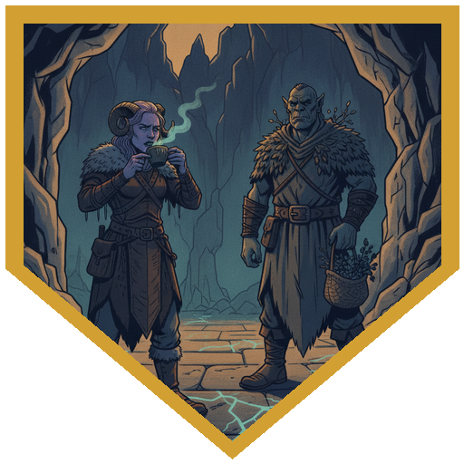
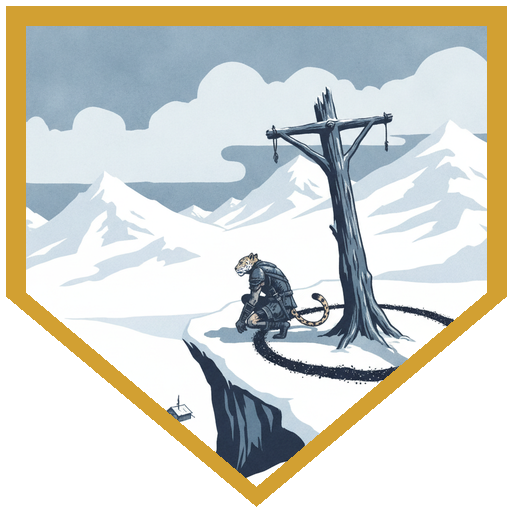
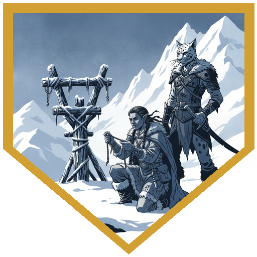
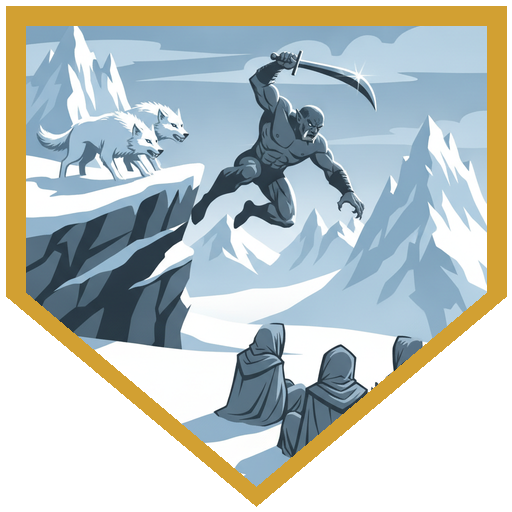
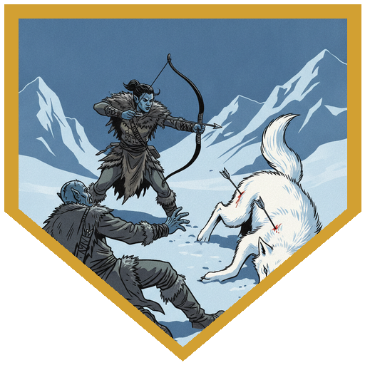

Before anyone left Coldpeak, [Durok](../npcs/durok) found Alina in [the Great Hall](../locations/the-great-hall). He had taken her hotter-colder idea seriously, and the pull was strongest right where the meals happen, about where she would have sat. Then he brewed her a tea from a satchel of foul-smelling herbs. "This will taste horrible." She had to drink the whole cup and keep it down (Constitution 19), and spent ten queasy minutes poisoned. Then, on an Arcana 17, she saw it: faint striations running out from that spot, across the floor and out of the hall, and down into the ground itself, like the roots of a fresh sapling spreading wider than the thing you can see. Whatever was dropped there is taking root. While the tea sits in your stomach, the mountain overlooks you. Father Joseph tried it at disadvantage and couldn't get it down. Neither could River. Durok left them a satchel with two doses and offered to teach the brew. River found another map in his pack: the [standing stones](../locations/standing-stones), the cliff to their east, a mark on the cliff and a path running north and down. There was no settlement on it. Veska asked to come. She hunts, and that settled it.

[Grath](../npcs/grath) led them east past [Durok's Spring](../locations/duroks-spring), a day's walk that should have taken longer, and up the cliff, with River's claws doing most of the climbing. River's Perception 30 from the top took in the whole camp below: three large tents with cookfires, figures in gray robes, a trench dug from the stones toward [the Shaping House](../locations/shaping-house), a lodge built to last, and a smaller hut that might be stables. On that hut's roof was a hawk's perch of ordinary size. Up on the cliff where the party stood was the same perch, tremendously large, ringed with chardalyn dust. Alina's Arcana 18 read the dust as something like a teleportation circle, but different: the two perches are connected, and what passes between them is made bigger. Down there is a hawk. Up here is a gigantic one. There were no bones and no blood, so whatever lands here doesn't nest. Then River's Perception 26 found a cord caught at the edge, and Veska ran over. She had made it for [Tarn](../npcs/tarn): the knot they tied when they promised each other. He had been here. A path led north, and River's map put them on it.

The group sneaked down the switchback (a weak success, with Alina's Guidance helping), and River's passive Perception 20 spotted an orc running flat out across the snow. Three of the great white wolves were behind him, with three gray-robed mages behind them. Until now the Brotherhood had been a name behind other people's trouble. This was the first time the party drew steel on it. Father Joseph opened with Synaptic Static, and not one wolf saved: 31 psychic damage. Alina's Fireball caught all three for 22. The mages answered with force bolts, and one crit Alina for 36 before Berg's Interception took 10 off, the first time he'd used it since the very first session. Veska crit and dropped a wolf. The wolves breathed frost across the switchback, and River's Evasion took none of it. Berg looked at the slow way down, then jumped (Athletics 24, six damage), landed among the mages, and started taking them apart. River's sneak attack finished one for 21, Veska crit a second wolf, and Berg dropped another mage. Joseph's Eldritch Blast finished a wolf, and he dropped prone out of the last mage's sight. Alina hammered that mage, and River's Steady Aim shot finished him on 24. The wolves' collars melted into the snow.

Tarn was weak. River gave him a healing potion, and Veska and Tarn had their reunion the Coldpeak way: a moment, and then on. The creature had carried them to the perch and landed, and then it was gone, and gray robes were waiting. They were taken underground with him: an Elk scout named Ysolde, and [Pasha](../npcs/pasha). Tarn squeezed out through a hole in a cellar shaped by magic, and the guards know about that hole now. There are others in there too, people from the Ten Towns, and every so often the gray robes take some of the downtrodden from Dougan's Hole, and those ones he hasn't seen again. The separate building belongs to a very powerful wizard, Corwen Tallis. River asked if anyone had flammable chemicals, but setting the building on fire would kill the prisoners. And there's a bear, bigger than any bear Tarn has ever seen, and quicker than it looks. It has always been there. He only got out because it was the only guard there that one time. River's map led north to a rubble-choked stone stair and a door with a Netherese symbol, a password door like the ones at the Shaping House. Alina's Intelligence 18 remembered that [the Propaganda Doll](../items/the-doll) in her pack knew the word. Beyond it was a warm passage, built so that walking from the cliff down to the Shaping House would be comfortable, and it cuts right across the Brotherhood's trench. There's a ladder up, and a door that is certainly guarded. On the other side are Pasha, Ysolde, the wolves, the gray robes, and the bear. Whenever the party opens it, they'll have advantage on initiative.

## Player Highlights

<strong><a href="../characters/dr-medicine">Father Joseph</a></strong> (Erilyn) — Opened the fight with Synaptic Static at DC 18, and not one wolf saved: 31 psychic damage and a d3 off everything they tried afterward. Couldn't get Durok's tea down at disadvantage, but now has it in reach whenever the patron needs to look the other way. Finished a wolf with Eldritch Blast, then dropped prone so the last mage couldn't see him.

<strong><a href="../characters/river">Roaring River</a></strong> (Eric) — Took a Perception 30 from the clifftop, then a 26 found Tarn's cord at the edge of the perch. Found another map in his pack that turned out to be exactly the right one, and spotted Tarn running for his life with a passive 20. Evasion turned the wolves' frost breath into nothing. His sneak attack killed one mage for 21, and his Steady Aim shot killed the last for 24.

<strong><a href="../characters/alina">Alina Shandorath</a></strong> (Dominic) — Drank Durok's tea and kept it down on a 19, then saw what nobody else could: the pebble's roots spreading under the Great Hall. Read the giant perch on an 18: the two perches are connected, and what passes between them comes out enlarged. Fireballed all three wolves for 22, and took a 36-point crit and stayed standing. Opened the Netherese door with an Intelligence 18 and the doll in her pack.

<strong><a href="../characters/berg">Berg Wurdnowwah</a></strong> (Josh) — Used Interception for the first time since the first session and took 10 off the 36-point crit on Alina. Then, instead of the switchback, he jumped (Athletics 24, six damage) and landed among the mages, with Distracting Strike setting up his own next hit. Two of them didn't get up. "If there's one hole, there might be others."

## Achievements

<strong>This Will Taste Horrible</strong> — Durok offered to drink it with her. Alina kept the whole cup down, and with the mountain looking elsewhere, she saw the roots of a small, indistinguishable pebble spreading through the floor of the Great Hall and deep into the stone.

<strong>Two Perches</strong> — A hawk's perch on a hut roof below, and the same perch on the cliff above, big enough for something that could carry off a mammoth, ringed in chardalyn dust. Down there is a hawk. Up here is a gigantic one.

<strong>The Knot</strong> — A cord caught at the edge of the perch. Veska ran over before anyone could ask: she'd made it for Tarn, the knot they tied when they promised each other. He'd been here.

<strong>The Short Way Down</strong> — The switchback was the slow way. Berg jumped instead, rolled a 24 on Athletics, took six damage, and landed among three Brotherhood mages who hadn't planned for that.

<strong>She Hunts</strong> — Veska is young, but she hunts, and in her tribe that makes her an adult. She crit twice, dropped a wolf, and got Tarn back.

## Rewards

- **Durok's tea** — a satchel holding two doses, and Durok will teach the brew. Once you've drunk it, for as long as it takes to digest, Arveth overlooks you. If you can't get it down, you can't try again for about as long.
- **River's map** — the standing stones, the cliff, and the hidden Netherese stair to the north
- **Tarn** — rescued, and he has told the party what's inside
- **Advancement** — milestone; no level change this session
