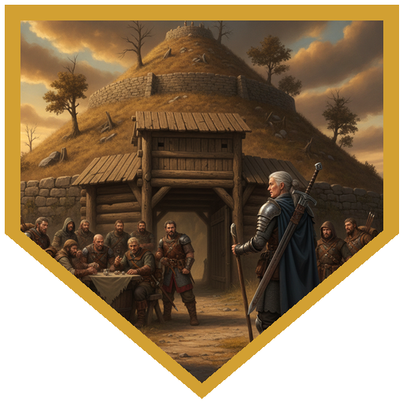
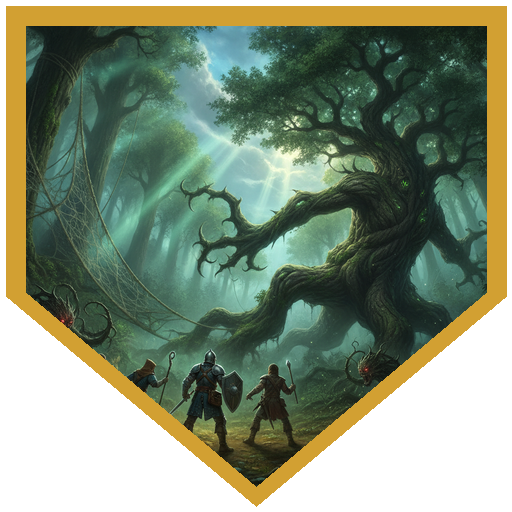
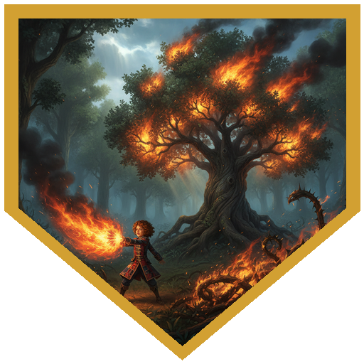
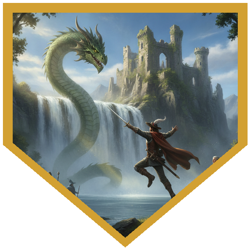
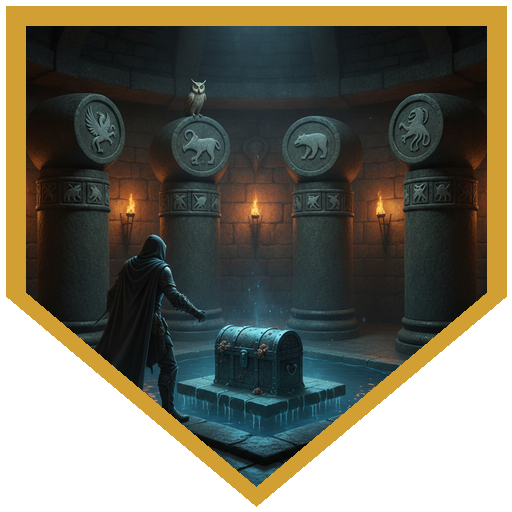

Aeldwyn One-Arm had one more thing to do before her end-of-life rites. Years ago she had left her greatsword, Breathtaker, in the keeping of a guardian in the Welkwood. A priest of Kelanen among her old companions had offered to carry her soul into the blade when the time came, and that could not happen until the sword was back in her hand. She was coming along herself, since the guardian would not hand it over to anyone else, but she wanted younger, stronger company for the trip. The villagers were more excited about the party than villagers usually are, mostly because the party was travelling with *her*, and they had one warning: the bandits of Stalkara were charging tolls on the road north. Orin said he didn't pay tolls on free roads. On the way out of town a brother and sister of about eighteen, him with a short sword he plainly couldn't use and her with a hunting bow, asked to tag along as far as a place called Hill Harren. An insight check turned up the part they had left out: they were running away and hadn't told their parents. Nobody felt it was their place to parent. A few hours up the road, a cart came barrelling toward the party with goblins on wolfback behind it. Orin's arrow and Madmartiken's blade knocked riders off their mounts, Huckleberry's Shocking Grasp made sure a third wouldn't be reacting to anything, and the riderless wolves bolted. The grateful driver, back from a very profitable Richfest, poured everyone ale from a keg, handed over a pouch of gold, and passed on the useful part: the bandit leader, Otelia, had been badly wounded, and a healer might be worth more to the bandits than a toll.

At the gate below Stalkara's earthwork hill, a dozen warriors were throwing dice. They wanted ten gold apiece "for the enrichment of the land." The party asked which of them was the land, demanded representation, and floated a magic-beans scheme. Then Orin offered a counteroffer called an ass-whipping, and Aeldwyn pointed out that she would rather not start a fight on her farewell tour. The healing angle worked. A young warrior led them up to the mead hall. This was Otelia's son Jopash, who knew Aeldwyn from his mother's stories under an older name, *Blood-Hair*. Only Cir Mevut and Aeldwyn were allowed into the back room. Cir's medicine check found the problem: the stab wound in Otelia's belly had gone septic, beyond the reach of a quick spell or potion. Aeldwyn spent two days nursing her back with herbs while the rest of the party drank with mercenaries who turned out to be surprisingly normal and who spoke well of their boss. Orin used the time to work his guide contacts. Two neighbouring lords were fighting over land to the west, and the safer route was to keep to the road as far as Carrion Keep, then cut into the Welkwood north of the fighting. The bandits also said to stay well away from the Keep, because it was haunted. And the two runaways, after one very persuasive conversation, decided that a mercenary band with a boss who paid well was close enough to adventure for now.

The Keep turned out to be exactly as advertised: pale stone the colour of a sun-bleached skull, four crumbling towers like a skeletal hand reaching up out of the ground. In the Welkwood, Orin picked out thick spider webs, Franjean and Rool found where the spiders' territory ended, and the party sneaked around the edge without a fight. Then they asked themselves why the spiders stayed out of that patch of forest. The answer was vine blights and two awakened trees. A blight grabbed Madmartiken, and a critical slam from one of the trees put him on the ground. Cir Mevut spent the fight pulling people back up with Divine Spark and Healing Word, which made him the trees' next target, and he went down too until Orin's Healing Word got him back on his feet. Huckleberry's fire did double damage against the trees, and Orin's critical hit, with his last Dreadful Strike on top of it, took one apart. Finally, with the owl's help giving him advantage, Madmartiken chopped down the last tree.

Past a labyrinth of giant roots, a waterfall poured from beneath a ruined, vine-choked castle into a misty lake. Aeldwyn had the party call out the guardian's full titles, which Madmartiken delivered after casting Jump on himself for no clear reason. A green dragon's head parted the waterfall: Verdigrim, Emerald Sovereign of the Welkwood. He sneered at "Blood-Hair" for bringing whelps to do her dirty work and asked what she had brought as a replacement. She hadn't brought one, so he named a price. Carrion Keep held the hoard of a necromancer nobody had seen in a long time, and Verdigrim wanted some of its magic. He showed them a secret mile-long tunnel past the undead at the gates and kept Aeldwyn as collateral. Inside, the party found a mural room with a poison-gas pressure plate on the top step. Orin set it off, came through it, and memorised the five desert animals painted on the wall. Next came a corridor wired with electrified filament where more than a dozen zombies crowded in, and Madmartiken's radiant blade was very happy to see them. The last zombie dropped a Hat of Disguise and a cell key. The cells were a chain of keys and bones that ended in a flooding trap. Under the rising water, the party found a Figurine of Wondrous Power, a serpentine owl, unlocked a two-keyhole door just in time, and flew over the electrified water that followed them into the hall. In a shrine to Istus, Cir read the past and future altars. Then Orin turned five rotating pillars to *serpent, bird, lizard, bird, serpent*, and the bottom of a fifteen-foot pool rose up carrying a chest with a Bowl of Commanding Water Elementals inside. Two rare items seemed like enough. Verdigrim's green-skinned kobolds went through their packs at spear-point, the dragon took the best of it, and he handed back the hat, the greatsword, and Aeldwyn. She looked at Breathtaker like an old friend and grinned up at him. *"Depart my domain,"* he told her, *"before I remember the emptiness of my belly."*

## Player Highlights

<strong><a href="../characters/huckleberry">Huckleberry</a></strong> (Dan) — Arrived properly wild this time. Opened the goblin fight by putting 14 lightning into a rider with Shocking Grasp: "He won't be reacting anytime soon." "...Ever again." Against the awakened trees, Burning Hands and every fire spell after it did double damage. In the zombie corridor he landed a critical Chromatic Orb for 25, and later used Shocking Grasp on the zombie next to him so it couldn't react, then walked away.

<strong><a href="../characters/cir-mevut">Cir Mevut</a></strong> (Brian) — The real healer, who doesn't pretend. He was one of only two people allowed into Otelia's sickroom, and his medicine check found the infection that no single spell could fix. Against the trees, he used Divine Spark and second-level Healing Words to bring Madmartiken back from unconscious and then Huckleberry. That made him the tree's priority target, and it put him on the ground. Inside the Keep, he identified the shrine of Istus: past on one altar, future on the other, and the present walking down the aisle between them.

<strong><a href="../characters/orin-darkward">Orin Darkward</a></strong> (Trey) — Doesn't pay tolls on free roads, and said so at the gate. He guided the party through his home country with advantage, worked the bandits for rumours, and spotted the spider webs in the Welkwood. In fights he and his owl worked as a pair: the owl darted in to give him advantage, and Orin shot from whatever dark corner he'd claimed. His crit plus his last Dreadful Strike tore 21 out of an awakened tree, and when the tree dropped Cir, Orin's Healing Word got him back up. He stepped on the poison plate in the mural room, shrugged off the gas, and remembered the five animals on the wall, which was exactly the order that opened the pool.

<strong><a href="../characters/madmartiken">Madmartiken</a></strong> (Ken) — Cast Jump roughly every thirty seconds all session, including right before addressing the dragon. He used his clockwork amulet to guarantee a hit and knocked a goblin clean off its wolf for 16. A vine blight grabbed him and a tree crit put him on the ground, and he got back up still swinging. He delivered the full invocation to Verdigrim, "Devourer of Dreams, he of the Merciless Maw," without missing a title. Then he went through the zombie corridor with a radiant blade: "I love fighting these guys. They don't complain about holding still."

## Achievements

<strong>Sometimes in That Order</strong> — At Stalkara's tollgate, the bandits wanted ten gold a head "for the enrichment of the land." The party asked which of them was the land, demanded representation, pitched magic beans, and offered an ass-whipping, until someone noticed the bandits had asked about healers. "We have skills across the gamut. We kill and we heal." "Sometimes in that order."

<strong>Why the Spiders Stay Away</strong> — Orin spotted the webs, Franjean and Rool found where the spider territory ended, and three of the four stealth rolls came in over 20. The party slipped neatly around the edge, then had to wonder why the spiders avoided this part of the forest. A bush moved. Then the trees did.

<strong>It Burns Hotter</strong> — "Burninate, Trogdor." Huckleberry's Burning Hands hit the vine blights and awakened trees, and the leaves went up in smoke. Every fire spell he cast after that did double damage. The tree he scorched swung back at him, and he answered with more fire.

<strong>Devourer of Dreams</strong> — Aeldwyn's voice wasn't what it used to be, so Madmartiken cast Jump on himself and called across the lake: "O great and mighty Verdigrim, Emerald Sovereign of the Welkwood, Devourer of Dreams, he of the Merciless Maw, we humble ourselves before thee." A green dragon's head parted the waterfall. He was not pleased to see who they'd brought.

<strong>Serpent, Bird, Lizard, Bird, Serpent</strong> — Orin paid for the mural with a lungful of poison gas, and wrote down the five desert animals painted on it. Two rooms later, in a shrine to Istus, five rotating pillars carried the same symbols. He turned them into that order, and the floor of a fifteen-foot pool rose up with a chest on it.

## Rewards

- **Mark of Prestige: *Bandit-Friend*** (all) — Because of you and your companions, Otelia of Stalkara is alive. Her son Jopash owes you a favor.
- **Orin Darkward** — **Moon-Touched Rapier** *(Weapon, Common)* and **63 gp**. In darkness, the unsheathed blade sheds moonlight: bright light in a 15-foot radius and dim light for another 15.
- **Cir Mevut** — **Moon-Touched Rapier** *(Weapon, Common)* and **63 gp**.
- **Huckleberry** — **Staff of Flowers** *(Wondrous Item, Common)* and **63 gp**. As an action, you can make a flower of your choice sprout from the staff's tip, and it can serve as a spellcasting focus for a stage magician whose tricks keep coming true.
- **Madmartiken** — **125 gp** (took the gold).
- **Hat of Disguise** — taken off the zombies and handed back by Verdigrim as the party's share. Offered as the treasure-bundle option; nobody took it.
- **Carried out of Carrion Keep and handed to Verdigrim:** a Figurine of Wondrous Power (Serpentine Owl) and a Bowl of Commanding Water Elementals.
