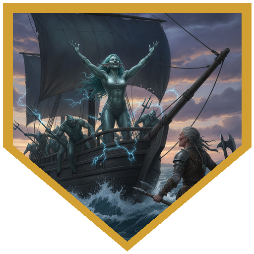
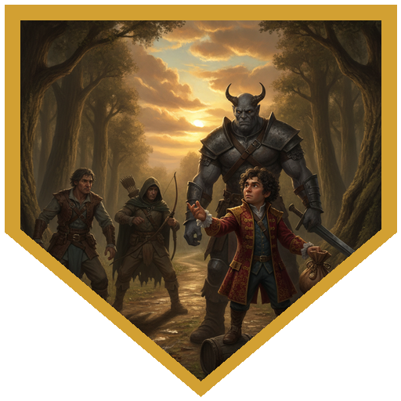
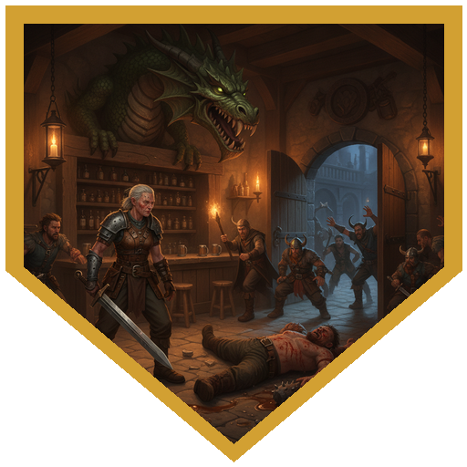
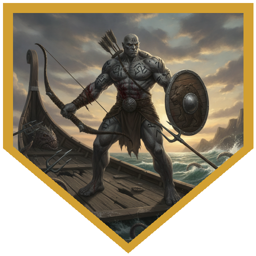
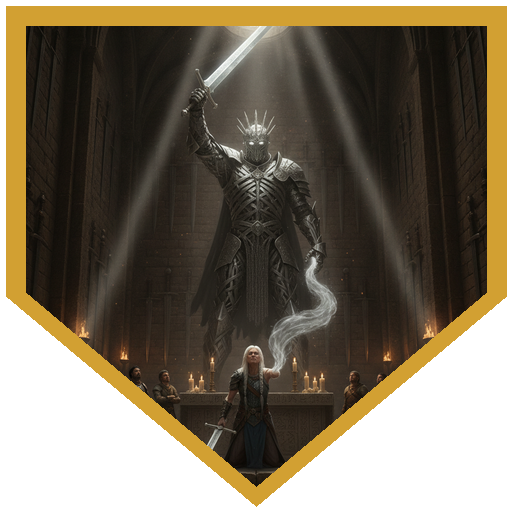

With Breathtaker back in her hand, Aeldwyn One-Arm had one thing left to do: reach the Temple of Kelanen in Elredd, where the priest Winfleda would carry her soul into the sword. Her champions sailed with her toward Fax, joined this time by Nimbus, a big, quiet hunter out of Highfolk. Cir Mevut sat this one out. The ship carried four other passengers: Ebbo Goldpot, a well-dressed halfling from Greyhawk on unspecified "business"; Volkbert, a hard-eyed man guarding his "trade goods" and keeping to himself; Hulda of Safeton, a nervous young woman headed to a carpentry apprenticeship; and Ylladi Spindrift, by all appearances a silver-green aquatic elf, a scholar of the land-bound peoples of Oerik. Huckleberry spent the voyage working the deck, trying his new and very real wild magic in the act. Prestidigitation, a puff of smoke, and a Performance roll of 23.

The scholar was not what she claimed. Ylladi Spindrift was a malenti: a sahuagin born with the mutation that gives one of them the look of a sea elf (a "hideous sea elf," to her own kind), and she was one of Aeldwyn's enemies. She called sahuagin up out of the bay to finish the old woman off. Aeldwyn put Breathtaker in Madmartiken's hands, as she would in every fight to come. The fish-men came over the rails, a sahuagin priest among them, and Huckleberry dropped a Shatter on the cluster of them and the priest. Nimbus planted himself in the thick of it and took hit after hit. Ylladi went down with the rest of her raiders, and the ship made it to Fax.

Aeldwyn's past was waiting there too. At the Green Dragon tavern, Radovan Leg-Breaker and his crew came for her. Radovan died on the tavern floor, and what was left of his crew ran.

On the road from Fax to Elredd, a band of bandits tried to collect a toll. The party answered with a group Intimidation check, Huckleberry rolled well, and the bandits ended up paying the party instead: 20 gold, and a quick exit. The party also saw an omen on the road. Madmartiken, Nimbus, and Huckleberry each came away from it with Heroic Inspiration; Orin missed the sign on his Insight check. At the Temple of Kelanen in Elredd, Winfleda prepared the ritual, but the Lord of Swords would not grant Aeldwyn's request until she and her champions proved themselves worthy, and that meant facing Kelanen's avatar. The party faced the avatar and lived, Kelanen granted the honor, and Aeldwyn One-Arm's soul passed into Breathtaker.

## Player Highlights

<strong><a href="../characters/huckleberry">Huckleberry</a></strong> (Dan) — Now third level and more unpredictable than ever, he turned the voyage into a rehearsal: wild magic in the act, prestidigitation, a puff of smoke, and a 23 on Performance. When the sahuagin came over the rails, he caught a cluster of them and their priest in one Shatter. On the road to Elredd, he led the party's Intimidation of a band of toll-taking bandits, well enough that they paid <em>him</em>. The omen left him with Heroic Inspiration, and later he rolled two sixes on a Chromatic Orb, hitting with a 22 for 18 damage.

<strong><a href="../characters/orin-darkward">Orin Darkward</a></strong> (Trey) — Saw Aeldwyn through the last stage of the road he'd guided her along since the Welkwood, from the ship to the Green Dragon to the temple steps. The omen on the road to Elredd slipped past his Insight check. He walked out of Elredd carrying a Staff of Flowers.

<strong><a href="../characters/madmartiken">Madmartiken</a></strong> (Ken) — Aeldwyn's chosen blade-arm. In every fight, the bay, the Green Dragon, and the avatar of Kelanen, she put Breathtaker in his hands and let him swing it for her. He came away from the omen with Heroic Inspiration, carried the sword to the end, and took the gold.

<strong><a href="../characters/nimbus">Nimbus</a></strong> (Mike) — A hunter out of Highfolk on his first trip with this crew, and the one the enemies kept hitting. Sahuagin, Radovan's thugs, and finally the avatar of Kelanen all went at him, again and again, and he was still standing at the end. The omen gave him Heroic Inspiration as well. He left with a Moon-Touched Rapier.

## Achievements

<strong>A Scholar of Land-Bound Peoples</strong> — Ylladi Spindrift said she had come to study the peoples of Oerik. It turned out she was a sahuagin herself, a "hideous sea elf" by her own people's standards, and she had come for Aeldwyn One-Arm with more sahuagin climbing the hull behind her. She didn't leave the ship.

<strong>The Toll Runs the Other Way</strong> — Bandits on the road to Elredd wanted a toll. The party stared them down with a group Intimidation check, Huckleberry's roll carried it, and the bandits paid the <em>party</em> 20 gold to be on their way. "I'll take that fee."

<strong>Last Call at the Green Dragon</strong> — Radovan Leg-Breaker had waited a long time to settle things with Aeldwyn. He picked the wrong night and the wrong companions to do it in front of. Radovan stayed on the tavern floor, and the rest of his crew went out the door.

<strong>Still Standing</strong> — First session with the party, and Nimbus spent most of it soaking up the blows meant for someone else. Sahuagin, tavern thugs, the avatar of a god of swords: they all hit him, repeatedly, and he stayed on his feet.

<strong>Tempered by Kelanen</strong> — The Lord of Swords wanted proof that Aeldwyn's champions were worth the honor she was asking for. The party faced his avatar in the Temple of Kelanen in Elredd and lived to tell the tale. Kelanen granted the honor, and Aeldwyn's soul passed into Breathtaker.

## Rewards

- **Story Award: *Tempered by Kelanen*** (all) — You faced the avatar of Kelanen, Lord of Swords, and lived to tell the tale. The temple of Kelanen will always provide you with food and lodging whenever you're in Elredd.
- **Nimbus** — **Moon-Touched Rapier** *(Weapon, Common)* and **63 gp**. In darkness, the unsheathed blade sheds moonlight: bright light in a 15-foot radius and dim light for another 15.
- **Orin Darkward** — **Staff of Flowers** *(Wondrous Item, Common)* and **63 gp**. As an action, you can make a flower of your choice sprout from the staff's tip.
- **Madmartiken** — **125 gp** (took the gold).
- **Huckleberry** — **125 gp** (took the gold).
