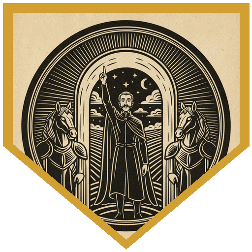
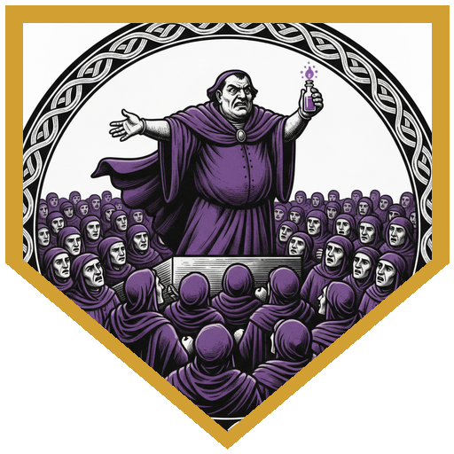
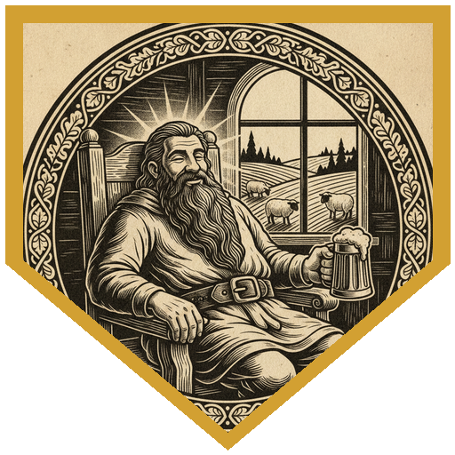
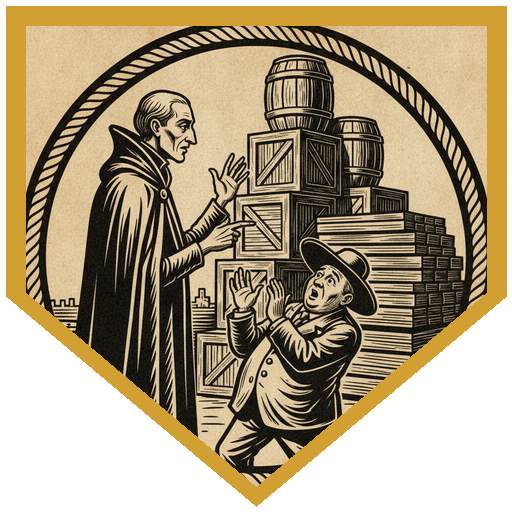
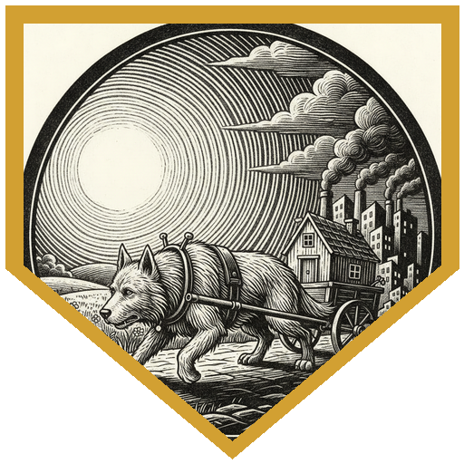

The pub crawlers were already singing on their way through Sigil when a seven-year-old girl on a bench spotted Perri, a small man on a very large dog, and decided he was the hero she needed: "I'm almost as big as him! Maybe he can help us." Perri asked if she could count to ten. Count von Kount offered to help. Her mother, Aelela, had scraped together fifty gold. Her husband, Garran Waiyre, had gone into Elysium as bodyguard to Thethi Goldenhand of the Goldenhand trading house on an eight-day trip and had been gone ten. The trading house had sent Hector's Heroes after them, and they hadn't come back either. People said Elysium was addictive and that once you went in you never wanted to leave, but a priest at the Gatehouse could cure it if they brought him home. She gave them a scroll of *sending* in case they needed help, and Luila gave them her drawing of her father. It was an amazing picture. Everyone talked about his beard.

A single rose opened the wire arch in the park, and the party stepped out onto a hillside of meadows and forest above Restover and its very tall clock tower. A pair of horse-headed equinals stopped them and asked what they had to declare. The Count declared that the number of the day was one. The guardinal agreed that one was a good number, but zero contraband was better. Perri's celestial sigil of compassion and Xavius's mark as a friend to angels earned smiles, and Waffles got his head ruffled for being a very good boy. Garran had come through, the guardinals said, and gone down to the town. People do decide to put down roots here. Elysium's bliss came with a DC 10 Wisdom save at every long rest. Perri's aura added +4 to everyone's save, but the Count still failed one and found the place full of wonderful things to count.

Sparrow's reliable talent kept her Persuasion at 17 or better all trip, and the trail ran town to town. In Restover, Thethi had bought a wagon he worried wasn't big enough for lumber and had wanted a souvenir of the clock. Greenedge was a sawmill and a house with a sign that said *beer*, full of men with beards like the one in the drawing. The Count was delighted to count all of them. In Oceanview, Garran kept getting wine in his beard while Thethi complained that the locals wore purple, which was supposed to be reserved for people of means. Perri's cloak of many fashions promptly turned purple. Rock Reef had a planar ship stuck on the reef and a smell of fish that drove Thethi out before nightfall. In Muscaton, among the wineries, Garran had asked where he could buy a stuffed woolen doll for his daughter. Along the way the party played merchant: lumber from Greenedge, a vial of purple dye for the Count, and a barrel of Elysian wine for Sparrow's portable hole. ("I'm thirteen years old. Are you being critical of the fact that a thirteen-year-old is buying a barrel of wine?")

They found everyone in the pub in Meadowbright: Garran, with a beard he could tuck into his belt, Thethi in a fancy purple cloak, and Hector's Heroes (a gnome, an elf, a human and an orc) arguing over which of them had been in charge when things went wrong. Garran wanted to go home. He had tried. "There's always five more minutes," he said. The bartender added that tying them up didn't work, and that the guardinals didn't like that kind of talk. The party convinced all six that they had a plan, and Langi and Xavius worked out that Thethi's horses were caught by Elysium too. On the road back, Langi failed his last save and wanted another day. At the portal the rescued shouted that they'd changed their minds, and a guardinal walked over to ask whether everything was okay. Perri, his owl and a 23 talked them out of it. Sparrow kept the guardinals busy telling her about other towns. Perri gave a speech about duty and the people who love you. The Count counted every item for an inspector until he decided everything was in order. Xavius cast Enhance Ability on himself and Waffles, and Waffles pulled the wagon through in place of the horses, who stayed behind to live on an actual farm. The box text promised dozens of snarling guardinals. Nobody had to fight. Sigil's air almost made them cough. Garran's howls lasted until he saw his family. Thethi paid out and gave them his purple cloak: it was supposed to protect him from all this, and clearly he'd been ripped off. The adventurers held an immediate vote and became Hestallia's Heroes.

---

## Player Highlights

<strong><a href="../characters/xavius-fairgate">Xavius Fairgate</a></strong> (Patman) — A planar traveler who set out to be an ordinary adventurer and kept ending up in faraway realms, now a regular on the pub crawls. His mark as a friend to angels from an earlier crawl got a smile from the guardinals at the gate. He burned luck points and heroic inspiration on the bliss saves, worked out with Langi that Thethi's horses were stuck too, and volunteered his 18 Strength to haul the wagon. His Enhance Ability on himself and Waffles gave the party an automatic success at the portal.

<strong><a href="../characters/perri">Perri</a></strong> (Trey) — Perri and Waffles are back, and Luila picked him out of the whole crowd. His aura put +4 on every Elysium save, and the celestial sigil of compassion on his forehead earned a smile at the gate. When the guardinal came to ask what all the shouting was, Perri talked him out of it on a 23, with his owl fluttering for advantage. He followed up with a 24 speech about duty and the people who love you, then hitched Waffles to the wagon.

<strong><a href="../characters/langi">Langi</a></strong> (Ttrpger) — A halfling beast master ranger who landed in Sigil after some Feywild shenanigans and came to Elysium for the pub crawl, then grudgingly tagged along on the rescue. In Meadowbright he asked whether something natural was keeping the rescued from leaving, and the DM rewarded the question: he and Xavius learned the horses were caught too. He suggested guilt-tripping the stragglers home, which earned Intimidation a place in the group check. Then he failed his own last save and wanted just one more day.

<strong><a href="../characters/count-von-kount">Count von Kount</a></strong> (Ken) — The nicest dhampir sorcerer-cleric you could hope to meet, from a place with a street named after some seeds. Ken first played him in this series back in 2024, when he got along famously with the modrons. He declared the number of the day at the gate, counted beards in Greenedge and profits in Oceanview ("one gold the profit, two gold the profit"), and failed a save because there was so much to count. At the portal he offered to cast Antagonize on the people they were rescuing, and the table said no. He settled for counting an inspector into submission instead.

<strong><a href="../characters/orsellia-fiddlesteps">Orsellia 'Orsy' Fiddlesteps</a></strong> (Lazarus) — A red-haired researcher with goggles on her head, a small dragon on her shoulder, and a dragon god's blessing earned by caring for wormlets. She shrugged off Elysium's pull every day. She admired Luila's drawing ("You really got his beard"), took Familiar Friend into the group check, and cast Emboldening Bond on the haulers at the portal. She also caught that Perri's aura turned Xavius's failed 6 into a pass.

<strong><a href="../characters/sparrow">Sparrow</a></strong> (Michael) — Sparrow Swiftfeather, permanently cursed to be thirteen and not happy about it, lives in a portable hole she rolls up and takes with her. She gave Luila bubble gum, did nearly every Persuasion check on the trail with her reliable talent, and loaded the trade goods into the hole. In Muscaton she bought a barrel of Elysian wine just for herself. At the portal she kept the guardinals busy asking about all the towns they'd missed. Her plan to have Xavius launch her over the enemies volleyball-style will have to wait for another night.

---

## Achievements

<strong>The Number of the Day</strong> — At the gate to Elysium, the horse-headed guardinals asked if the party had anything to declare. Count von Kount declared that the number of the day was one. The guardinal allowed that one was a good number, but zero was better: zero contraband.

<strong>Reserved for People of Means</strong> — Thethi Goldenhand spent the whole trip complaining that everyone in Elysium wore purple. Perri's cloak of many fashions immediately turned purple, and the Count bought a vial of the dye to sell in Sigil. At the end Thethi handed over his own purple cloak, having learned that the colour wasn't as exclusive as he'd thought.

<strong>Five More Minutes</strong> — Garran wanted to go home and kept sitting back down. There was always a flower to smell, a song to finish, a night too dark to travel in. "It's like when you're in bed and you're late for something. There's always five more minutes." Langi found out what he meant on the last day of the trip.

<strong>Everything Is in Order</strong> — An inspector at the portal asked to examine all those goods the party had bought. Count von Kount used Intimidation and began counting every item out loud, one piece at a time. The inspector decided it was fine: everything was in order.

<strong>A Very Good Boy</strong> — The horses wouldn't go through the portal, so Perri hitched up Waffles, Xavius cast Enhance Ability on the giant dog, and Waffles pulled the whole wagon out of paradise. The horses stayed behind to live on a farm, an actual one this time.

---

## Rewards

- **Gold**: 416.67 gp (2,500 gp split six ways: "Wouldn't have expected so many sixes in Elysium")
- **Downtime**: 10 days
- **Advancement**: level (optional)
- **Streaming hours**: 2
- **Mantle of Spell Resistance** (*Temperate*) *(wondrous item, rare, requires attunement)*: added to every player's available magic items list. Advantage on saving throws against spells while you wear this cloak, and you're unharmed by temperatures of 0 °F or lower and 100 °F or higher. It's dyed a royal purple that turns heads, and when it helps you resist a spell, constellations shimmer briefly across its surface. Thethi Goldenhand's thank-you gift; he had hoped it would protect him from Elysium.
- **Spell Scroll of Sending** *(scroll, uncommon; 3rd level, save DC 15, attack +7)*: added to every player's available list. Aelela's scroll went unused, since the party got everyone out without calling for help.
