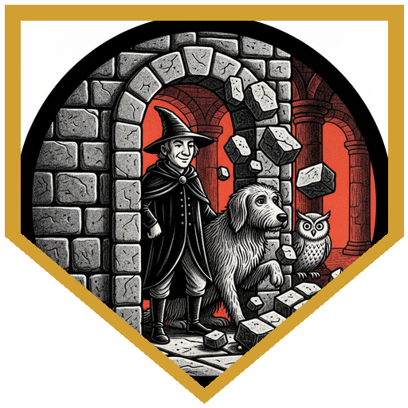
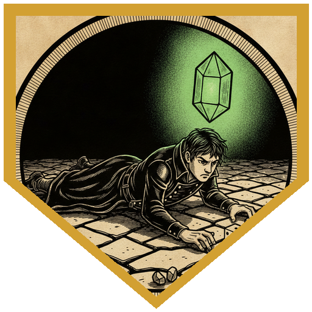
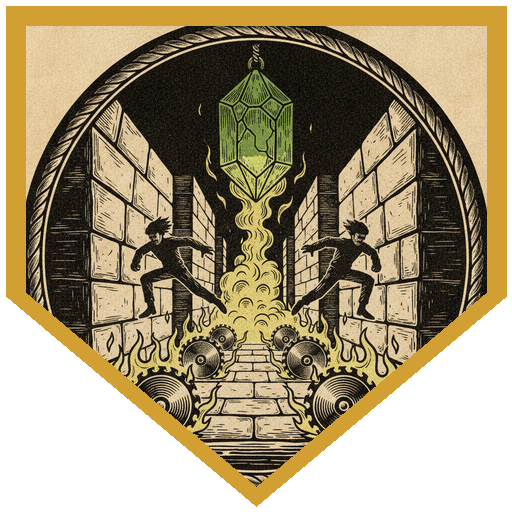
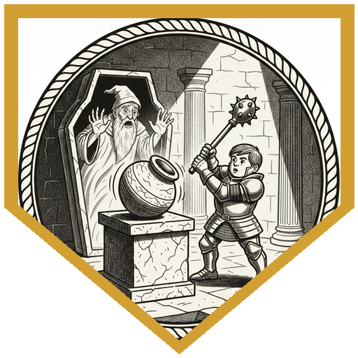

The pub crawlers' portal opened from the back room of a Hive Ward restaurant that smelled of oiled cabbage, and the moment it did, the only thing anyone could smell was acid. Carceri greeted them with a factory belching green clouds into the sky, a dark jungle all around, and a ramshackle tavern crowded with fiends. The drinks were poison cocktails garnished with scorpion tails, starting at a gold apiece. The frog-like bartender picked the adventurers out of the crowd immediately: they hadn't come for the drinks. He offered directions to Malikim Vile's prison for one gold now and the rest if they made it back. "Anyone else smell a grift?" Perri flipped him the coin anyway, and Pal Go Lucky added a four-leaf clover for being so helpful. Only Perri passed the DC 20 History check. Malikim was a Netherese wizard from some sixteen hundred years ago who made a deal with a demon to hop from body to body, wizard to wizard, until his own apprentices turned on him and locked him away on the prison plane.

The trip through the jungle came with a rolling layer of acidic fog. Perri burned a 3rd-level Air Bubble to cover himself, Waffles and Pal's pangolin Peppy, and inside the clear air he spotted an acid-eaten skeleton with a glass scroll case: a scroll of *Nystul's magic aura*. The prison tree was impossible to mistake: bloated and gnarled, twenty feet tall and twice as wide, split by a fissure into a stairway glowing dim red. Perri's Comprehend Languages read the runes on the walls as warnings to stay away and not unleash what was below. At the bottom, in a room painted with murals of staff-carrying wizards, a translucent old man with a pale white goatee welcomed them to his home. Sung Kenwoo had walked in with Detect Magic already running and warned everyone off the glyph in the middle of the floor. Malikim made clear he found every previous visitor embarrassing ("like watching an ant try to climb out of a tub") and that none of them was worth his time. Ken wasn't fooled: "We see where this is going."

Perri found the secret door with a 19, missed the trap, and opened it anyway. The wall came down on everything adjacent to him, which was Waffles and the familiars. ("I suppose that is one way to find a secret door.") Beyond it, buzzsaws swept a blood-stained corridor two feet off the floor beneath a pulsing green crystal. Mahgoli's wand of secrets turned up glyphs, so the party went down on their bellies, while Malikim encouraged them to crawl like the worms they were. Illy still caught a Thunderwave glyph that threw her ten feet in the air. Sung Kenwoo read the crystal with a 23 Arcana: alter its facets three times and something would happen. The first turn added a second set of blades along the floor. Mahgoli turned it next, with advantage from glassblower's tools, and the saws doubled in speed so going prone no longer helped. Pal's five-leaf clover didn't get the third turn done, and the saws came through for 26. Sung Kenwoo finished the job with a 17: the crystal cracked into a stinking cloud, and the saws began running twice a turn, on fire. ("He just keeps turning the trap up. Turn it the other way.") Pal, poisoned, took 34 from a flaming blade and kept walking. Illy gave the hit points back with a 3rd-level Cure Wounds, then a Mass Healing Word after the next door's rockfall. Malikim, by now laughing, decided they were entertaining enough to keep watching.

An invisible bridge led across a river of lava, a door hidden in the ceiling sat above another in the floor, and two chutes later the party landed in a chamber lined with portraits of wizards. Six costly vases stood on plinths, and a standing sarcophagus glowed red at the far end. Malikim tried to take Perri first and bounced off a paladin's +14 Charisma save. Mahgoli's trident and Illy's Sear Undead broke up the skeleton guard, and Sung Kenwoo's daggers finished the last one. Then Perri and Waffles pried the sarcophagus open, Malikim tried again, and Sung Kenwoo failed. Ken spent the next round doing push-ups inside a jar while his body threw daggers at Pal ("Why did I possess this guy?"). Pal Misty Stepped in and hit the restrained wizard with his moon-touched sword and scimitar. Ken rocked the jar, Illy worked out what it meant, and she smashed it, sending Ken home and Malikim back into his own body to die in his sarcophagus. The real magic jar would have been worth another 400 gold. There was no treasure hoard, only a staff, a spellbook and his enchanted titanium-and-platinum chains. The bartender was not happy to see them. After a few more hours of carousing, a portal opened in midair and dropped all eight pub crawlers and their guards onto the rubbish heap at the edge of the Hive Ward.

---

## Player Highlights

<strong><a href="../characters/mahgoli">Mahgoli</a></strong> (Ttrpger) — An earth genasi paladin of the Ancients who signed on as hired help to make sure everyone came home okay. In the buzzsaw corridor Mahgoli spent a charge from a wand of secrets to find the glyphs, then volunteered to crawl through first. Glassblower's tools earned advantage on the crystal's second facet, and Merge with Stone put a bonus-action Blade Ward up against the faster saws. With a minute left before leaving, Mahgoli put a trident through one of Malikim's skeletons.

<strong><a href="../characters/pal-go-lucky">Pal Go Lucky</a></strong> (Don) — White armor plastered with four-leaf clovers, Sailor Moon accents, and Peppy the peppermint pangolin. Pal had done every pub crawl except this one and wanted to know what the ale tasted like. He tipped the bartender a clover, threw a five-leaf clover into the air before turning the crystal, and walked through a poison cloud and 34 points of flaming buzzsaw. At the sarcophagus he Misty Stepped in and hit Malikim with his moon-touched sword and scimitar, and the possessed Sung Kenwoo needed a 20 to touch him.

<strong><a href="../characters/sung-kenwoo">Sung Kenwoo</a></strong> (Ken) — He presents as the weakest adventurer alive and secretly levels up. He hadn't been interested in pub crawls since <a href="2026-07-15">Automatic Updates</a>, until he heard about an impossible dungeon: "the perfect place to grind." He came in with Detect Magic running, read the crystal with a 23 Arcana, and turned its facets twice, Bladesong and all. When Malikim took his body, Ken did push-ups inside the jar and rocked it hard enough for Illy to notice. Afterward he asked if anyone minded him taking the spellbook. Nobody did.

<strong><a href="../characters/illy">Illy</a></strong> (Lazarus) — Eliandra, a deep gnome war cleric and former frontline infantry healer, still roaming in search of her sister. She caught the corridor's Thunderwave glyph and was thrown ten feet into the air, then cast Nondetection and kept crawling. Her 3rd-level Cure Wounds gave Pal back all 34 hit points the flaming saw took, and Mass Healing Word patched up the party after the rockfall. In the last chamber she burned through the skeletons with Sear Undead, worked out what the rocking jar meant, and broke it to bring Ken home.

<strong><a href="../characters/perri">Perri</a></strong> (Trey) — The only one who knew who Malikim Vile was, and the first to smell a grift. His Air Bubble covered Waffles and Peppy as well as himself and turned up the scroll. He became the party's official door-opener, the one person each trap never hit. He waited at the next door for his friends to catch up "so I can maximize damage," and explained that with fewer friends he'd get more money. When Malikim came for his body, a +14 Charisma save sent the wizard after someone else. On the subject of paladin spells: "I got so many more spells than paladin spells."

---

## Achievements

<strong>One Way to Find a Secret Door</strong> — Perri found the door, missed the trap, and opened it. The wall came down on everything next to him. Malikim: "Are you typically the one that would put your friends in danger just to make things faster for yourself?" Perri: "Yep. They know what they signed up for."

<strong>A Much Better Eleven</strong> — Sung Kenwoo rolled an 11 on his first Arcana check at the crystal and spent his heroic inspiration on the reroll. It came up 11 again. "Oh, you know what? That's a much better eleven. That feels good."

<strong>Turn It the Other Way</strong> — Three turns of the crystal's facets added a second set of blades, doubled their speed, and finally cracked it open into a stinking cloud with the saws running twice a turn, on fire. Malikim: "This is what you get for trying to make friends with the traps rather than avoid them. They're coming to hug you back." Perri: "He just keeps turning the trap up. Turn it the other way."

<strong>You Chose the Wrong Guy</strong> — Malikim's possession bounced off Perri, so he took Sung Kenwoo, and found himself with a body that threw daggers. ("Why did I possess this guy?") Ken did push-ups inside the jar and rocked it until Illy smashed it, and Malikim went back to his own body just in time to die in it.

---

## Rewards

- **Gold**: 420 gp each (the real magic jar, broken in the rescue, would have added another 400)
- **Downtime**: 10 days
- **Advancement**: level (optional)
- **Streaming hours**: 2
- **Staff of Charming** (*Unbreakable*) *(staff, rare, requires attunement by a bard, cleric, druid, sorcerer, warlock, or wizard)*: added to every player's available magic items list. 10 charges; expend 1 to cast *charm person*, *command*, or *comprehend languages* with your spell save DC. It can reflect an enchantment spell you save against back at its caster, or once per dawn turn a failed save against one into a success. It regains 1d8 + 2 charges at dawn, and if you spend the last one, a 1 on a d20 crumbles it to dust. *Unbreakable:* it can only be broken through the direct intervention of a deity. Malikim's spellcasting focus: yellowed carved bone that seems to grow slowly over time, covered in Abyssal inscriptions, mostly curse words.
- **Spell Scroll of Nystul's Magic Aura** *(scroll, uncommon)*: added to every player's available list. Found in a glass scroll case beside an acid-eaten skeleton in the Carceri jungle.
- **Malikim Vile's Spellbook** — Sung Kenwoo: *animate dead*, *cone of cold*, *counterspell*, *detect magic*, *detect thoughts*, *disguise self*, *fly*, *invisibility*, *light*, *lightning bolt*, *mage armor*, *mage hand*, *mind blank*, *misty step*, *Otiluke's resilient sphere*, *prestidigitation*, *scrying*, *shield*, *teleport*.
