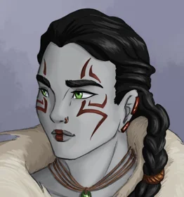
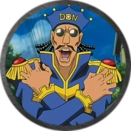
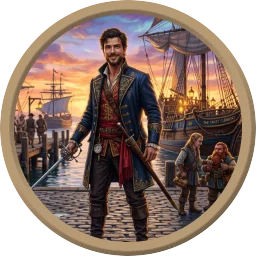
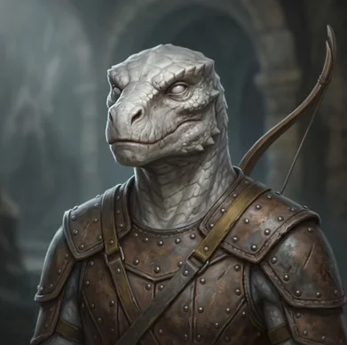
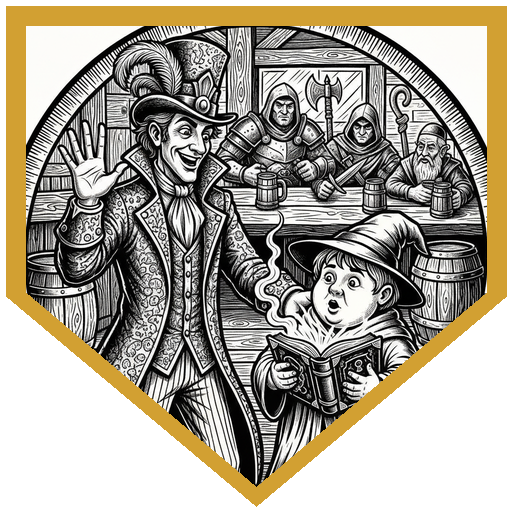
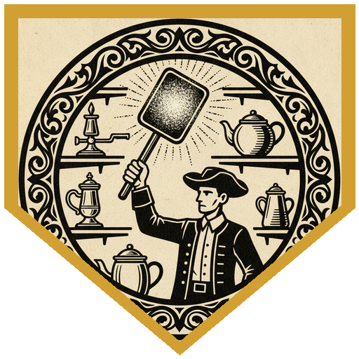
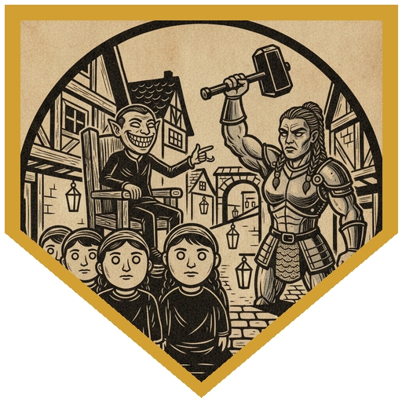
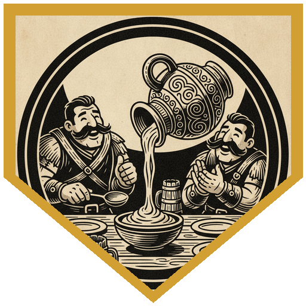

Luskan lives in the shadow of the Host Tower of the Arcane, and its people have long since stopped looking up at the flashes, bangs and coloured lights. They did look up when a bird made of fire glided down into the market. It was really a pair of burning hands spread like wings. Then a sheet of flame washed over a cabbage vendor's stall and two of them were setting the market alight. Don Kenonji announced that he smelled bad spirits and hit the first one with a Shillelagh for 11 force damage. Nella Thuunlakalaga stepped in with her warhammer and a Booming Blade on a 22 and dissipated it in a spark that shot off across the city. The second one caught Nella and Don in a sheet of flame for 12 apiece. Nella answered with another Booming Blade, her owl kept up the Help action, and Arthur's shortbow did the last eight points against a creature with four hit points left and resistance to spare. Its motes of magic flew into the open book of a chubby, out-of-breath young man running toward them.

He was Breeze Soak, an apprentice wizard. He had tried a ritual to protect his spellbook, the book exploded, and every spell in it got loose. The spells were at least somewhat intelligent and immune to their own kind of magic, and if knocked out they would go back to the book. He bought everyone a drink, told the bartender to look after the two who'd been burned, and offered to pay for every spell they brought back. Don Kenonji promised that the Luskan Five would defeat all enemies. There were four of them ("it averages to five"). After a short rest the party went hunting. Arthur tracked out-of-place elements like animal droppings, Dogma asked his white drake to sniff the spells out like a hound, Don recruited the street as a fan network on the lookout for bad spirits doing minor things maliciously, and Nella climbed the Host Tower itself to get a look over the city. Every roll succeeded, and they reached the next spell before it had wrecked an antique shop.

The spell was a ball of glittering light hopping from object to object in the shop. Some things it made glow and others it set on fire. The elf who owned the shop had tried to lure it out with an antique elven vase and been shot at for his trouble. It liked a silver candle snuffer, an old elven wash basin, a ceramic teapot and a dwarven beard-brush set, and hated a dwarven rug, an elven portrait and a wicker chair. Don guessed Faerie Fire. Nella's 17 on Arcana put it lower: a living Prestidigitation. Nella and Arthur worked out the pattern. Everything it liked snuffed, cleaned, groomed or warmed something. Arthur picked up a brass carpet beater, the spell settled around it and polished it, and he walked it all the way back to the tavern without a fight.

By sundown the magical lanterns were coming on, and the party pushed through a fleeing crowd into one that wasn't fleeing. It was carrying a small man in a chair, with a smile too wide for his face and teeth that shone in the dark. When one of the bearers shook her head and screamed, the crowd dragged her away, and the small man pointed at a stranger, who took her place with a glazed look. Arthur walked up to help carry the chair. The Living Charm Person turned to him: "I won't go back. Friends, save me from them!" The party fought to knock out, not kill. Don outlined most of the crowd in Faerie Fire, and only one bearer saved. Nella's warhammer was blocked when the spell pulled a commoner into the way. She took a crit from an opportunity attack, then left with a Cloud's Jaunt. Dogma's scimitar and his drake's cold-infused strikes knocked out two of the bearers. A shortbow shot left Arthur nearly down, and Don's Healing Word brought him back. The spell asked Nella whether she'd like to switch places with it, so she could take her own attack. She declined. It tried again with a 20, and Nella's Shield turned that one away. Arthur's 18 finished it. Breeze Soak heard the report and shook his head: both spells had been *changing*. Something beyond spells gone wild was at work, and he was going to his teachers. He paid them in gold and one of his student projects, an alchemy jug. Mayonnaise was the first request.

---

## Player Highlights

<strong><a href="../characters/nella-thuunlakalaga">Nella Thuunlakalaga</a></strong> (Gon) — A Thuunlakalaga of Wyrmdoom Crag, raised in Easthaven by parents who wanted her to learn more than the clan's trade, and who found she liked magic and could fish for knucklehead trout. It was her first time outside Icewind Dale. She opened with Booming Blade on a 22 and destroyed the first Burning Hands, then landed a 25 on the second. In the search she climbed the Host Tower to look out over the city. Her 17 Arcana identified the Prestidigitation, and against the Charm Person she Shielded a 20 and turned down its offer to trade places.

<strong><a href="../characters/don-kenonji">Don Kenonji</a></strong> (Ken) — Having already lived through <a href="2026-10-07">Part 2</a>, Don came back in time for Part 1 and greeted Breeze Soak with "Nice to meet you again for the first time." He announced the return of the Luskan Five, pulled his Hat of Disguise into a full Kanonji transformation, and got the streets watching for "badly sorted laundry." His Faerie Fire lit up all but one of the charmed crowd, his Healing Word kept Arthur standing, and his Shillelagh put a bearer down without killing him. Then, as manager, he claimed the fifth share.

<strong><a href="../characters/arthur-the-anchor">Arthur "The Anchor"</a></strong> (Trey) — A disgraced former naval officer turned privateer, a light, quick duelist whose sailor friends call him the Anchor because he drags the whole other side down in a fight. His shortbow finished the second fire spell with one point to spare. He chose the brass carpet beater and led the Prestidigitation home. He tried to slip in as a chair-bearer, spent the fight in melee he didn't want, and took the Charm Person down with an 18 the first time he got a turn out of melee.

<strong><a href="../characters/dogma">Dogma</a></strong> (Ttrpger) — A reborn drakewarden who looks like the dragon-kin he was before, with a white-scaled drake matching his old scales. He vaulted behind a table on the first turn and sent the drake for cover behind the crates. In the search he treated it like a bloodhound and told it to sniff out the spell, and the roll succeeded. Against the charmed crowd he went nonlethal: scimitar hits topped off with a d6 of the drake's cold knocked out two bearers in two rounds.

---

## Achievements

<strong>It Averages to Five</strong> — Don Kenonji promised Breeze Soak that the Luskan Five would defeat all enemies. Breeze pointed out there were four of them, or six, depending on how you counted. "Exactly, it averages to five." (The Luskan Five had been six the first time, in <a href="2026-10-07">Spells Gone Wild</a>.)

<strong>The Carpet Beater Gambit</strong> — The living Prestidigitation polished a candle snuffer, a wash basin, a teapot and a beard brush, and burned an antique vase. Arthur reached past the candlestick and the golden spoons for a brass carpet beater. The spell settled around it, made it shine, and followed him all the way back to the tavern.

<strong>Would You Like to Switch Places?</strong> — The Living Charm Person had already pulled a commoner in front of Nella's warhammer once. Mid-swing, it offered to trade places with her. "Come on, you're not entertained by the possibility of taking damage from your own attack?" She wasn't, and nobody else at the table was willing either.

<strong>I Always Wanted Mayonnaise</strong> — Breeze Soak's thank-you gift was one of his student projects, an alchemy jug. Nella: "Oh, mayonnaise, let's go." Arthur: "I always wanted mayonnaise."

---

## Rewards

- **Gold**: 57.5 gp each (20 gp per player, plus Breeze Soak's 150 gp split four ways; Don Kenonji, as manager, proposed a fifth share for himself)
- **Downtime**: 10 days
- **Advancement**: level (optional)
- **Streaming hours**: 2
- **Alchemy Jug** *(wondrous item, uncommon)*: added to every player's available magic items list. As an action, name a liquid and the jug produces it: acid, basic poison, beer, honey, mayonnaise, oil, vinegar, water, or wine, in set daily amounts. Breeze Soak's student project, given in thanks for bringing his spells home.
