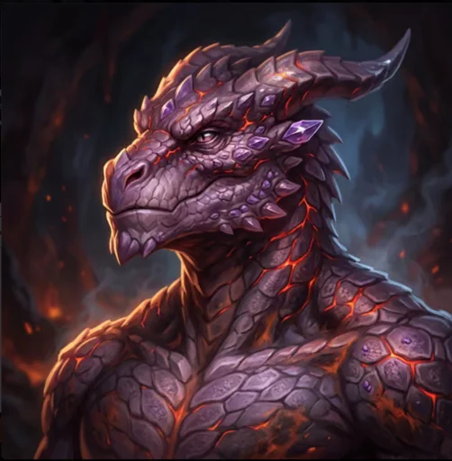
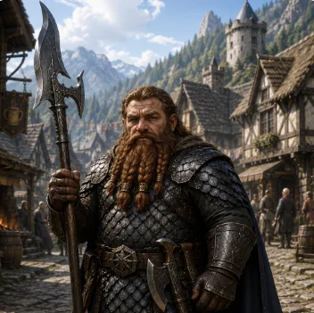
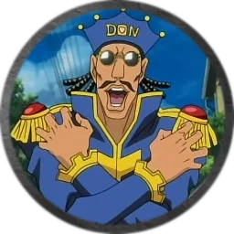
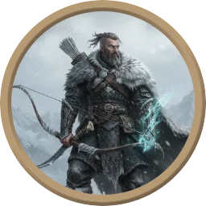
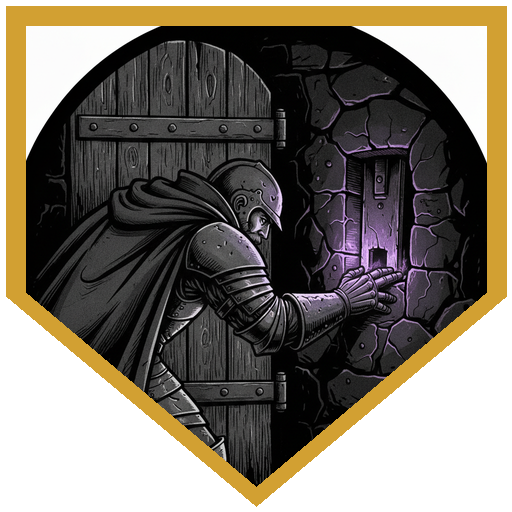
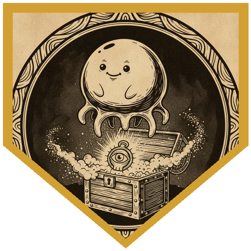
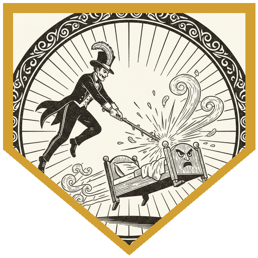
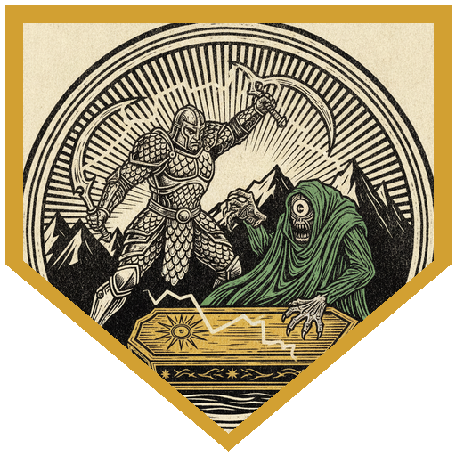
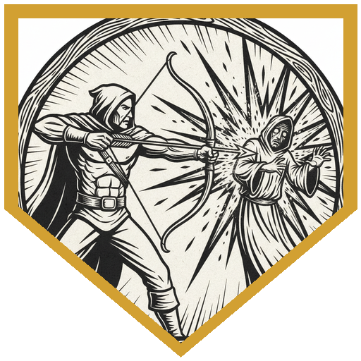

The Host Tower of the Arcane was finally taking Breeze Soak's problem seriously. Escorted into a back room of the Magic Drum by Tower guards, five veterans of the living-spells mess found the haggard young apprentice spreading maps across the table. The Cult of Vecna had been behind the sabotage all along, and the Host Tower was launching coordinated raids on their hidden sites in the Spine of the World. Their target was warded against scrying and likely trapped, so Breeze handed over a sending stone for extraction, promised twenty gold each plus twenty per spell destroyed (hedging at "six, seven, maybe" before Don Kenonji wrote him down for sixty-seven), obligingly cast *Mage Armor* on Don from Halite's spare scroll, and opened a portal into a mountain fjord half a mile from the cave.

Don Kenonji's *Guidance*-boosted 15 tipped the group check on the approach, revealing a magical rockslide glyph that Brogladeen disarmed on a 20 with Sleight of Hand. Inside the cave mouth, purple light seeped from cracks in the rock toward an iron door with a hand-sized hole beside it and a warning: *"Only for those worthy and willing to sacrifice."* Dru's owl, Wise Old, peered inside and found old bloodstains, a lever, and a guillotine blade lined up right at wrist height. While the party debated bread baguettes, owl wings, and hooked ropes, Jorin lost patience, trusted his magical bracers, and shoved his arm straight in. The blade dropped with a loud *shink* and slid harmlessly sideways into the stone, raising the door—a test of willingness, not an actual toll. Beyond it lay a smoothed cavern hall where four purple goblinoid Living Magic Missiles were trying to smack a thin man atop an animated bed—a Living Sleep spell—that was actively trying to crush them back. Don Kenonji's 19 Performance failed to march them obediently into a spellbook, so the party went to work. Halite deleted the first Magic Missile on a reaction attack the moment it crossed into his glaive's reach ("My friend kills you. That's twenty gold," Jorin remarked), Dru one-shot a second with *Poison Spray*, and Halite raged in Wolf aspect to drop a third. Jorin marked the bed and shrugged off its Sleep save with a 19 before Don Kenonji exorcised it mid-charge with an opportunity attack from his *Shillelagh*, then Brogladeen—finally breaking a cold streak—dissipated the last, beefier Magic Missile into wisps.

Then Jorin's *Hunter's Mark* caught up with the room's purple glow. A 7 on the wild magic table popped a friendly, embarrassingly gassy flumph into existence beside him, while Jorin and Dru both cleared the DC 13 Arcana check to identify the radiation as Underdark *faerzress*. The laid-back flumph floated clockwise through the side rooms for Jorin—breathing in the smell of simmering stew in the kitchen, checking the cultists' sleeping quarters with their pleading letters from home and thirty silver, and helping Jorin inspect (14) and pick (15) a locked footlocker holding a gem, forgery and disguise kits, and an unholy symbol of Vecna. *"Hey, that's a symbol of—"* it started, and vanished as its minute ran out, leaving Don Kenonji to compose a tribute song to the tune of *"Lump."* Dru floated the idea of disguising themselves in cultist robes; Jorin glanced over at Halite slapping himself to keep his rage alive and judged stealth a lost cause, but Dru grabbed a couple of robes anyway, just in case.

Past the ornate Vecna double doors, purple braziers smoked around seven cultists chanting over a golden sarcophagus holding their leader, Ohan the Green Cloak. Brogladeen cashed in Bardic Inspiration to turn a miss into a 13, tacked on *Thunderous Smite* for 19 damage to erase the first cultist, and triggered *Gift of the Gem Dragon* to blast away another who dared stab him. Halite took down a second cultist on a reaction, and then Ohan folded in on himself—not ascending to godhood as he had hoped, but crawling out of the sarcophagus as a grotesque one-eyed Nothic. Its *Weird Insight* pried into Halite's mind ("I'm resistant to piercing, bludgeoning, and slashing damage right now"), and its *Rotting Gaze* still burned Don Kenonji for 7 necrotic through a 17 Con save. Dru spent a Luck point to land an upcast *Guiding Bolt* and a *Luminous Arrow*—triggering a faerzress surge that wired him to *Reincarnate* if he died within the hour—and Jorin hammered the Nothic for 16. Don Kenonji buoyed "Luskan Blue" Brogladeen with 9 temporary hit points from the Spirit of the Wayfarer and dubbed Halite "Luskan Silver." When Brogladeen missed his opening scimitar swing on Ohan, Jorin reminded him his Nick property still gave him his second strike; he swung again, hit, dropped a free *Divine Smite* for 12 radiant to end the Nothic, and rolled a 97 on wild magic to get his earlier smite slot refunded. Dru's *Luminous Arrow* and Halite's glaive cleared the remaining cultists down to one last straggler on single-digit hit points, whom Jorin crit for 34 damage—prompting a table joke that the overkill must have byte-overflowed him back to 251. With Ohan's faerzress-tinted *Cloak of Protection* and the sarcophagus remains in hand (and Dru politely declining Halite's offer to test out that *Reincarnate* surge), they stepped outside the ward, pinged Breeze Soak on the sending stone, and returned to the Magic Drum to collect their pay.

---

## Player Highlights

<strong><a href="../characters/dru-go-lucky">Dru Go Lucky</a></strong> (Don) — Arrived with six-leaf clovers, goodberries, Wise Old, and Lucky the singing clover in his pack, then cheerfully played along when Don Kenonji came back through the Hat of Disguise for seconds ("Oh, trickster"). He scouted the guillotine hole through Wise Old's eyes, dropped a Living Magic Missile in one shot with 10 poison damage from Poison Spray, and tossed a clover into the air to spend a Luck point on a 2nd-level Guiding Bolt and Luminous Arrow into the Nothic. He also voluntarily reminded the DM to roll faerzress wild magic on his spell, picking up a one-hour Reincarnate contingency—prompting the observation that coming back as a dwarf would help him fit in better with his adoptive family, though he still declined Halite's offer to test it.

<strong><a href="../characters/brogladeen">Brogladeen</a></strong> (Ttrpger) — Disarmed the fjord's rockslide glyph on a 20 with Sleight of Hand, then spent half the night fighting cold digital dice before turning it around in the ritual chamber. He burned Don Kenonji's Bardic Inspiration to vaporize the first cultist for 19 damage with Thunderous Smite, blasted two separate cultists off their feet with Gift of the Gem Dragon (one of them rolling a 1 on the save), and—after a timely Nick reminder from Jorin—swung again to finish Nothic Ohan with a 12-radiant Divine Smite. The resulting wild magic surge rolled a 97 and handed his earlier smite spell slot right back.

<strong><a href="../characters/halite">Halite</a></strong> (Mike) — Opened at the Magic Drum by handing out the spell scrolls he couldn't cast from <a href="2026-10-07">Spells Gone Wild</a>, then turned his 10-foot glaive reach into a hazard zone, deleting both a Living Magic Missile and a Vecna cultist on reaction attacks before they could act. His Wolf-aspect rage fed advantage to the whole front line—and kept stealth completely off the table as he stomped around slapping himself to stay angry. When Nothic Ohan probed his mind for a secret, Halite cheerfully offered "I'm resistant to piercing, bludgeoning, and slashing damage right now," and wrapped the night by asking Dru if he wanted to roll the dice on becoming a Goliath or a Dragonborn.

<strong><a href="../characters/don-kenonji">Don Kenonji</a></strong> (Ken) — Thrilled to be back "in the future" after playing Parts 1 and 2 out of order, Don used his Hat of Disguise to score a second six-leaf clover from Dru and tucked one behind each ear. His 19 Performance couldn't make the living spells march home, so he settled for exorcising the charging Living Sleep bed with an 8-damage Shillelagh opportunity attack—then critting the boss Magic Missile for the exact same 8 damage. In the ritual room he kept "Luskan Blue" Brogladeen upright with 9 temporary hit points from his new College of Spirits Wayfarer tale, dubbed Halite "Luskan Silver," and immortalized the vanished flumph with a parody of "Lump."

<strong><a href="../characters/jorin">Jorin</a></strong> (Trey) — Still looking for Captain Deudermont and still getting dragged into living-spell crises, Jorin broke the stalemate at the guillotine door by simply reaching in and pulling the lever ("I was willing to toss the dice because you guys were sitting there talking about it too long"). His Hunter's Mark triggered the night's first wild magic surge, gifting him a chill, gassy flumph companion who scouted the side rooms and helped him pick the locked footlocker on a 15. He also called the Nothic "HAL 2000," reminded Brogladeen how Nick works just in time to kill it, and closed the fight by critting the last barely-standing cultist for 34 damage.

---

## Achievements

<strong>Willing to Sacrifice</strong> — Wise Old spotted old bloodstains and a guillotine blade waiting at wrist height inside the door's lever hole. After listening to plans involving baguettes, owl wings, and ropes, Jorin trusted his magical bracers and shoved his arm straight in. The blade dropped with a loud <em>shink</em> and slid harmlessly sideways into the wall—Vecna's door only wanted to see who was willing.

<strong>Float With the Currents, Man</strong> — Jorin's Hunter's Mark tripped the cave's faerzress and rolled a 7, summoning a relaxed, loudly gassy flumph ("You gotta just float with where the currents take you, man"). It sniffed cultist stew, opened every side door, helped Jorin crack the leader's footlocker, and vanished mid-sentence on "Hey, that's a symbol of—" right before Don Kenonji memorialized it to the tune of "Lump."

<strong>Exorcised in Mid-Charge</strong> — Bloodied by Jorin's arrows, the animated Living Sleep bed tried to barrel past the front line toward Brogladeen and trample Halite on the way. Don Kenonji took the opportunity attack ("You can't escape the premier spiritualist!"), smacked it for 8 force damage with his Shillelagh, and dropped the bed mid-charge—then immediately rolled a crit on his own turn for the exact same 8 damage.

<strong>Swing Your Scimitar Again</strong> — After muttering that he couldn't buy a double-digit roll all night, Brogladeen missed the Nothic Ohan and started to end his turn—until Jorin cut in to explain that Nick still gave him his second weapon attack even on a miss. Brogladeen swung again, connected, tacked on a free Divine Smite for 12 radiant to finish the Nothic, and rolled a 97 on wild magic to get his earlier smite slot refunded.

<strong>Byte Overflow</strong> — One cultist was left standing on single-digit hit points after taking the butt of Halite's glaive. Jorin stepped around with Wolf-aspect advantage and rolled a critical hit for 34 damage—nearly four times a full cultist's hit points. The DM joked that it caused an 8-bit overflow, resetting the cultist to 251 hit points.

---

## Rewards

- **Gold**: 35.4 gp each (177 gp total from Breeze Soak's payment, the magical theory books, the footlocker's gem, 30 silver from the cultist quarters, and the remains of the golden sarcophagus, split five ways)
- **Downtime**: 10 days
- **Advancement**: level (optional)
- **Streaming hours**: 2
- **Cloak of Protection** *(wondrous item, uncommon, requires attunement)*: added to every player's available magic items list. Grants a +1 bonus to Armor Class and saving throws while worn. Recovered from Ohan the Green Cloak: *the green cloak has a subtle purple glow of faerzress that can be seen if you look closely enough. When the hood is drawn over the wearer their face will be covered in shadow save for their left eye which will shine.*
