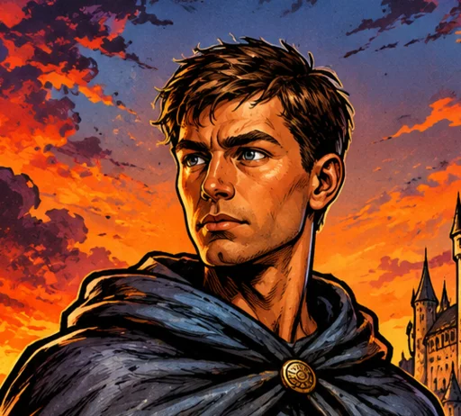
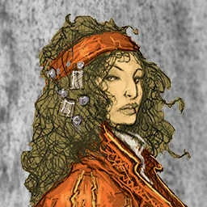
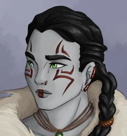
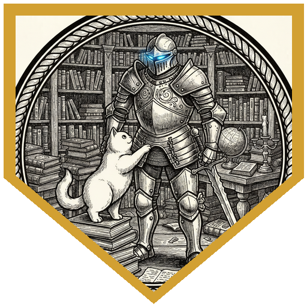
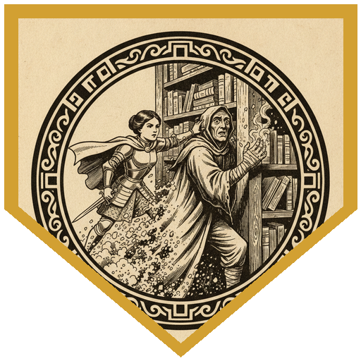
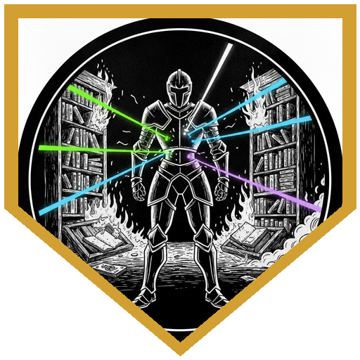
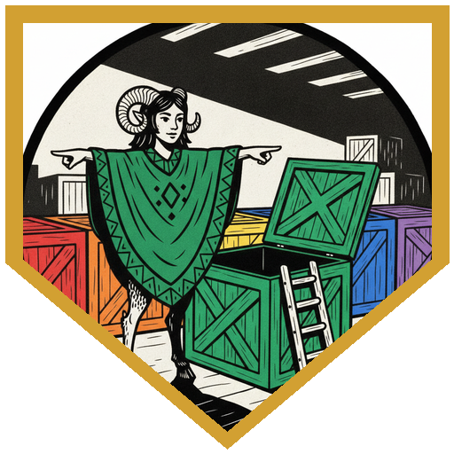
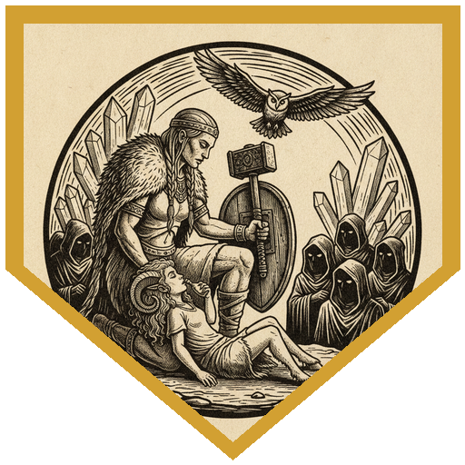

Breeze Soak was late again, and he dropped half his papers again on the way in. The rotund young wizard laid out his trouble for the newcomers at the Magic Drum: a ritual meant to make his spellbook *enduring* had instead brought ten or twelve of his spells to life, and only three (Burning Hands, Charm Person, and Prestidigitation) had been brought back so far. The ritual scroll had come from a shop called the Whispered Tome, and he offered 70 gold to anyone who could find out more. Inishka's 15 on Perception picked out research on the Weave, maps of every living-spell sighting, and backup scrolls of Sleep, Magic Missile, and Mage Armor that Breeze promised to hand over if the spells came home. Lady Kithri's Insight read nothing behind his scattered manner except a newly elevated wizard in over his head. Gwynne suggested he ask the local squirrels, who usually know a lot about tree magic. Breeze said he would keep it in mind.

The Whispered Tome stood in a nearly abandoned corner of Luskan, tucked behind the charred sign of the Fried Rat. Inside, between dusty shelves, a decorative suit of plate armor stood in the corner, and Wilbur Watley read behind the counter with his left hand bandaged. Inishka's ritual *Detect Magic* lit up a few books, the scrolls behind the counter, and the armor, and her 17 on Insight caught Wilbur fretting whenever anyone got near the armor, along with a bandage that showed no blood at all. Nella spotted a lockbox beneath the counter. Then Inishka's curious cat Firefloof padded up to the armor and tapped it with a paw. It was a Living Mage Armor, and it swung at once, ending Firefloof for the evening. Wilbur dropped the act. He shrugged off Lady Kithri's *Sleep* with a 20 (she gave him props), then answered with *Hold Person*, which she threw off with a Luck point. A spectral dagger appeared beside her, and her *Shield* kept her untouched. After that came a long siege against the armor's AC 18. Starry Wisps, Chromatic Orbs, Ray of Frost, and warhammer swings all went wide, so many of them on an 11 that Dan started calling it the night's number. Gwynne finally gave up on the armor and headbutted Wilbur instead. Lady Kithri finished him with a natural-20 Sneak Attack, meaning to knock him out for questioning. Wilbur declared Vecna the true god of magic, and the tattoo beneath his bandage burned him to dust. Vaelric then landed a critical Ray of Frost on the armor, and Lady Kithri's 19-point Sneak Attack burst it into a stream of sparks that flew off toward the Host Tower of the Arcane.

Lady Kithri opened the lockbox with her elbow, Fonzie-style, just to show that she could. Hidden in one of the books was a note, legible only under *Detect Magic*, ordering the living spell delivered to the warehouse nearest the walls on Dragon's Beach. There the party found a dozen boxes painted in the colours of the rainbow and a riddle, and Gwynne solved it: the child of the third and fifth colours, yellow and blue, was green. The green box was the only one not trapped, and it held a ladder down into smooth, spell-carved halls where the cult kept its bedrolls, a cooking pot, and books of Vecna magic. Lady Kithri's Religion check made sense of the Draconic texts. Past a hanging blanket, Lavinia stood in dark robes at the centre of a ritual circle lit by glowing crystals, with two Cultist Fanatics and three cultists around her, and none of them stopped chanting when the party walked in.

Lady Kithri went straight through the cultists and crit Lavinia for 18 ("Come on and join the party, guys!"). Gwynne's *Faerie Fire* caught no one, and three cultists piled onto her until a critical hit dropped her. Nella hammered one of them off its feet, then fed Gwynne her own healing potion. Vaelric's *Sleep* landed between the two fanatics and both resisted it. Back on her hooves, Gwynne took a standing satyr leap out of reach and dropped a cultist with a Starry Wisp, the first person she had ever killed, which left her horrified. Inishka finally remembered Innate Sorcery and burned a cultist down. Nella spent her Action Surge to drop Lavinia, choosing to leave her alive for questioning, then shield-bashed a fanatic prone. Inishka crit the other fanatic with a cold Sorcerous Burst that exploded for 18. Lady Kithri ended the first fanatic, and Gwynne's last Starry Wisp ended the second. In the storage room they found several *Hats of Disguise*, component pellets, an unholy symbol of Vecna, and a faintly glowing leather map of the Spine of the World. Under *Detect Magic*, the map showed a cipher too difficult to crack. Back at the Magic Drum, Breeze was horrified and grateful in equal measure. He paid them, handed over the promised scrolls, and swore to take the map straight to the overwizards of the Arcane Brotherhood.

---

## Player Highlights

<strong><a href="../characters/gwynne">Gwynne</a></strong> (Erilyn) — Left the Quivering Forest after hearing about druids who cast their spells from books ("turns out they're not druids"), and is just as happy to be paid in pastries. When her Starry Wisps would not land on the armor ("my punishment for taking all support spells"), she trotted over and headbutted Wilbur instead. Dan granted her the minimum 1 damage. She solved the rainbow riddle, went down to a cultist's crit, took Nella's potion, then made a satyr's standing leap out of reach and killed her first person with a Starry Wisp, to her own horror. The last Starry Wisp of the night ended the final fanatic.

<strong><a href="../characters/lady-kithri-p">Lady Kithri P.</a></strong> (Michael) — Arrived in Luskan planning to donate a thousand gold and at least seven magic items to a local temple. She traded spells with Wilbur (her <em>Sleep</em> against his <em>Hold Person</em>, which a Luck point and a <em>Shield</em> saw off) and offered him a draw "before I kill you," then ended the duel with a natural-20 Sneak Attack and finished the Living Mage Armor with 19 more. She opened the lockbox with her elbow just to show off, then charged straight through the cultists to crit Lavinia for 18.

<strong><a href="../characters/vaelric-mithathar">Vaelric Mithathar</a></strong> (Mark) — A young Waterdhavian who fancies himself a wizard, Vaelric worked out a routine in the bookshop: come down from the upper floor, fire a spell, and duck back behind the railing. All the while his raven sat on a bookcase squawking, which Mark called taunting the party for being so ineffective. His three-dart Magic Missile was the first real damage on the armor, and his critical Ray of Frost set up its end. In the hideout he dropped <em>Sleep</em> between the fanatics and spent Luck points to keep his frost on target.

<strong><a href="../characters/inishka">Inishka</a></strong> (Patman) — The budding Spellfire sorcerer walked into the Whispered Tome with <em>Detect Magic</em> and <em>Mage Armor</em> already up, and her 17 on Insight caught Wilbur's bloodless bandage. Her cat Firefloof found out what the armor was the hard way. She burned Wilbur for 15 acid with a Chromatic Orb, and once she remembered Innate Sorcery in the hideout, she crit a fanatic with a cold Sorcerous Burst. Erilyn noticed an 8 among the damage dice, which meant another die and 18 cold in all. "They made sorcerer essentially the casino mage," Erilyn noted.

<strong><a href="../characters/nella-thuunlakalaga">Nella Thuunlakalaga</a></strong> (Gon) — Gave Gwynne a thumbs-up when she ducked behind her, then squared up to the cat-killing armor. It turned aside her warhammer all night, but it never got through her own <em>Shield</em>, and her owl spent every turn granting Help. In the ritual room she smashed a cultist off its feet, fed Gwynne her own healing potion, spent her Action Surge to drop Lavinia (alive, so someone could find out what she was planning), and shield-bashed a fanatic prone.

---

## Achievements

<strong>Curiosity</strong> — Wilbur kept warning everyone away from his "unstable" armor. Firefloof the cat padded right up to it, sniffed, and tapped it with a paw, and the armor came alive swinging. ("You're not gonna believe this. It's animated armor.") Firefloof was out for the night, and the party had found their living spell.

<strong>Call It a Draw</strong> — Wilbur shrugged off Lady Kithri's <em>Sleep</em> with a 20, and she shrugged off his <em>Hold Person</em> with a Luck point. "You've cast a spell on me, I've cast a spell on you. Why don't we call it a draw before I kill you?" He didn't take the offer, so she pinned him to the wall with a natural-20 Sneak Attack: "It's time for you to go to sleep, my friend." He declared Vecna the true god of magic and burned to dust.

<strong>Should Be AC 13</strong> — "I feel like its AC should be reduced to thirteen since it's mage armor," Gwynne argued, as attack after attack against the Living Mage Armor's AC 18 came up an 11. Acid, frost, starlight, and lightning rained across a shop that was, per Dan, already destroyed. ("This was not supposed to be a ten-round combat.") Vaelric's critical Ray of Frost finally cracked it, and Lady Kithri's 19-point Sneak Attack sent it streaming home toward the Host Tower.

<strong>Child of the Third and Fifth</strong> — A dozen rainbow-painted boxes, all but one trapped, and a riddle from the dead man's note. Gwynne worked it out: the third colour of the rainbow is yellow, the fifth is blue, and their child is green. The green box held the ladder into the cult's hideout.

<strong>Get Behind the Goliath</strong> — Gwynne's plan when the armor came for her was "run behind Nella, she looks strong," and Nella answered with a thumbs-up. In the ritual room, with Gwynne down to a cultist's crit ("fresh character, no items"), Nella hammered a cultist off its feet and poured her own healing potion into the satyr. Then she spent her Action Surge to drop Lavinia.

---

## Rewards

- **Gold**: 32.3 gp each (161 gp total: Breeze Soak's 70 gp fee, 50 gp for the Living Mage Armor, and the Vecna texts from the hideout, split five ways)
- **Downtime**: 10 days
- **Advancement**: level (optional)
- **Streaming hours**: 2
- **Hat of Disguise** *(wondrous item, uncommon, requires attunement)*: added to every player's available magic items list. While wearing it, you can cast *Disguise Self* at will, and the spell ends if the hat is removed. One of several found in the cult's storage room: *it can look like any other hat, but it always keeps a mauve tint, whatever you want it to appear as.*
- **Spell scrolls** of *Sleep*, *Magic Missile*, and *Mage Armor*: added to every player's available list. These are Breeze Soak's backups, which he no longer needs now that his spells are coming home.
