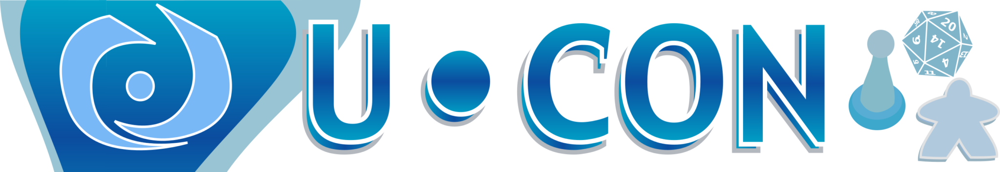



# U-Con 2026: Adventurers League & Legends of Greyhawk

**U-Con Gaming Convention · November 13–15, 2026**
Ann Arbor Marriott Ypsilanti Hotel at Eagle Crest

Thank you to all the players and DMs who came out and shared a table with us at U-Con 2026! Running a room like this only works because of the people who volunteer their weekend and bring great energy to every slot. We're already looking forward to next year and hope you can join us again.

---

## What We Ran

This year we ran two D&D organized play programs side by side: **Adventurers League** and **Legends of Greyhawk**.

- **{{ ucon_slot_count }} slots** across the weekend, Friday morning through Sunday afternoon
- **{{ ucon_al_count }} Adventurers League adventures** across all four tiers
- **{{ ucon_log_count }} Legends of Greyhawk adventures**
- **Epic** (multi-table event) Saturday evening
- **Charity rerolls** raising **$250** for Doctors Without Borders

  <a class="lp-btn ghost" href="{{ '/ucon-2026-schedule/' | relative_url }}">
    View the 2026 AL / LoG Schedule Archive →
  </a>

---

## Charity

Every table offered charity rerolls benefiting **Doctors Without Borders**, with bonus **Toy Red Dragon** certificates for donations of $5 or more. Together we raised **$250** this year. Thank you to everyone who pitched in!

  <a class="lp-btn ghost" href="{{ '/ucon/rerolls/' | relative_url }}">
    How charity rerolls worked →
  </a>

---

## Ideas for Next Year

Have feedback from this year, an adventure you'd love to see next year, a time slot that would work better, or anything else that would make U-Con even more fun? Send me a note any time. Every suggestion gets read.

---

## Questions?

Reach out any time. I genuinely love talking about this.

- **Email:** chapmand@gmail.com
- **Discord:** hoshisabi · [Join the server](https://discord.gg/4x7p2NPs4Q)
- **Web:** [hoshisabi.com](https://hoshisabi.com) · [pandodnd.com](https://pandodnd.com)

---

## Past U-Cons

Thank you to everyone who has volunteered or played at our tables over the years. This room has been running strong almost a decade and exists because of the people who keep showing up.
